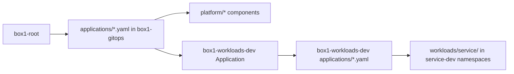

# box1-docs

Backlog, achievement logs, runbooks, agent prompts and agent run state for
**Box1**, a single-node OpenShift homelab platform and its flagship reference
application, **box1 Operations** (orders, site inventory, fulfillment through a
legacy ERP, telemetry, notifications, an operator console and AI operations).

- **Read in Developer Hub (TechDocs):**
  <https://developer-hub.apps.ocp.box1.org/docs/default/component/box1-docs>
- **Interactive service map:**
  <https://box1-org.github.io/box1-docs/architecture/service-map.html>
- **Source:** <https://github.com/box1-org/box1-docs>
- **Backlog:** <https://github.com/box1-org/box1-docs/issues>

This README is also the TechDocs home page: `docs/index.md` includes this file
unchanged, so edit `README.md` only. Links point at GitHub with absolute URLs so
they work both on GitHub and in TechDocs.

The repository is **public**. Never commit credentials, tokens, private keys,
kubeconfigs or unredacted authentication logs.

## What is in this repository

| Area | Contents |
| --- | --- |
| [Backlog (GitHub Issues)](https://github.com/box1-org/box1-docs/issues) | The shared backlog for all Box1 work: bugs, platform workstreams, service prompts and follow-ups |
| [`achievements/`](https://github.com/box1-org/box1-docs/tree/main/achievements) | Dated achievement logs (`achievements/YYYY/YYYY-MM-DD-topic.md`): outcome, baseline, changes, evidence, final state and follow-ups |
| [`runbooks/`](https://github.com/box1-org/box1-docs/tree/main/runbooks) | Operational procedures for platform features and services |
| [`agent-runs/`](https://github.com/box1-org/box1-docs/tree/main/agent-runs) | Durable state of frontier-profile agent runs, one directory per issue |
| [`box1_operations_agent_prompts/`](https://github.com/box1-org/box1-docs/tree/main/box1_operations_agent_prompts) | The prompt library used to build box1 Operations with coding agents |
| [`manual/`](https://github.com/box1-org/box1-docs/tree/main/manual) | Inventory and redacted backup of cluster objects created by hand rather than by GitOps or an operator |
| [`architecture/`](https://github.com/box1-org/box1-docs/tree/main/architecture) | Service map of HTTP calls and Kafka topics between the services |
| `mockups/` | UI mockups. The operator console mockup is on the unmerged branch [`issue-18-operator-console-mockup`](https://github.com/box1-org/box1-docs/tree/issue-18-operator-console-mockup/mockups/operator-console); it is not on `main` yet |
| [`Box1_Operations_White_Paper_v4-2.pdf`](https://github.com/box1-org/box1-docs/blob/main/Box1_Operations_White_Paper_v4-2.pdf) | The box1 Operations concept white paper |

### Backlog

All Box1 work is tracked in
[box1-org/box1-docs issues](https://github.com/box1-org/box1-docs/issues),
whichever repository the change lands in. Check for an existing issue before
filing a new one, and record verified symptoms, current mitigations, remaining
work and acceptance criteria. Issues with a temporary workaround stay open until
the permanent fix is done.

Labels used beyond the GitHub defaults:

| Label | Meaning |
| --- | --- |
| `frontier` | A whole service or platform prompt run end to end under the frontier execution profile |
| `needs_prompt` | Work that needs an agent prompt written before it can start |
| `resilience` | Fault tolerance, recovery and durability follow-ups |
| `workaround` | A temporary mitigation is in place; the permanent fix is still open |
| `cve` | Vulnerability tracking |

Using the GitHub CLI:

```sh
gh issue list --repo box1-org/box1-docs
gh issue view <number> --repo box1-org/box1-docs
gh issue create --repo box1-org/box1-docs --title "..." --body-file issue.md
```

### Achievement logs

[`achievements/`](https://github.com/box1-org/box1-docs/tree/main/achievements)
records what was delivered, one file per distinct achievement, named
`YYYY-MM-DD-short-topic.md` with America/New_York dates. Each log leads with the
outcome, then the starting baseline, what changed, validation evidence, the final
operational state (including deliberate differences from `main` and temporary
workarounds) and recovery steps and follow-ups linked to issues. Later logs link
earlier ones rather than repeating history, and corrections to an earlier log are
made explicitly.

Recent examples cover the Developer Hub onboarding refactor and Keycloak OIDC,
the RHEL image mode VM golden path, the order, inventory, notification and
scenario-controller services, the fulfillment adapter, the legacy ERP appliance,
the operator console and observability.

### Runbooks

| Runbook | Covers |
| --- | --- |
| [Dev Spaces developer environment](https://github.com/box1-org/box1-docs/blob/main/runbooks/dev-spaces-developer-environment.md) | Box1 UDI, devfile commands, Tekton, remote dev, JVM debug, Kaoto, Claude Code, Hawtio |
| [Kafka and PostgreSQL foundation](https://github.com/box1-org/box1-docs/blob/main/runbooks/kafka-postgres-foundation.md) | Shared Kafka cluster and per-service PostgreSQL |
| [OpenShift AI lab](https://github.com/box1-org/box1-docs/blob/main/runbooks/openshift-ai-lab.md) | OpenShift AI workbench and KServe validation |
| [RHDH onboarding plugin: OCI delivery](https://github.com/box1-org/box1-docs/blob/main/runbooks/rhdh-onboarding-plugin-oci.md) | Publishing the onboarding plugin as an immutable OCI artifact |
| [RHDH onboarding durable workflow](https://github.com/box1-org/box1-docs/blob/main/runbooks/rhdh-onboarding-refactor.md) | Operating and resuming the Developer Hub onboarding workflow |
| [Service decommissioning](https://github.com/box1-org/box1-docs/blob/main/runbooks/service-decommission.md) | Retiring a golden-path service and its GitOps, CI and catalog entries |
| [Site Expansion back-out](https://github.com/box1-org/box1-docs/blob/main/runbooks/site-expansion-backout.md) | Removing the #126 edge sites and their golden-path changes, in three levels, against the `pre-site-expansion-2026-11-09` tags |

Platform component runbooks live next to their manifests in `box1-gitops`
(see [below](#box1-gitops-platform-desired-state)).

### Agent prompts and agent runs

[`box1_operations_agent_prompts/`](https://github.com/box1-org/box1-docs/tree/main/box1_operations_agent_prompts)
is an executable prompt library for building box1 Operations with coding agents:

- `00-shared/`: agent contract, domain contracts, repository and GitOps
  conventions, quality gates, execution plan, handoff template, resource and
  security boundaries, and the
  [frontier execution profile](https://github.com/box1-org/box1-docs/blob/main/box1_operations_agent_prompts/00-shared/07_FRONTIER_EXECUTION_PROFILE.md).
- `01-services/`: one prompt per deployable service (order, inventory,
  fulfillment adapter, ERP VM simulator, telemetry, notification, experience BFF,
  operator console, scenario controller, AI operations).
- `02-platform/`: platform workstreams (contracts and data, observability, mesh
  and rollouts, trusted delivery, virtualization, AI inference, developer portal
  onboarding).
- `manifest.json` and `PROMPT_MANIFEST.md`: prompt index, dependencies and order.

Two execution profiles share these prompts: the default `qwen-64k` profile (one
acceptance slice per session) and the `frontier` profile, where one agent owns a
whole prompt across phases and keeps its state outside the conversation.

[`agent-runs/`](https://github.com/box1-org/box1-docs/tree/main/agent-runs) holds
that frontier state, one directory per run, named `<issue>-<short-topic>`:
`run.json`, the `requirements.yaml` ledger, a resumable `checkpoint.md`, one
record per decision in `decisions/` and redacted `evidence/`. A run works on its
own `agent-run/...` branch and merges its directory to `main` when it ends or
stops for the owner. Run state never goes in `box1-gitops` or a service
repository.

### Manual installs and backups

[`manual/manual-installs-and-secrets.md`](https://github.com/box1-org/box1-docs/blob/main/manual/manual-installs-and-secrets.md)
lists what was created on the cluster by hand (operators, cluster configuration,
Secrets by name only), how ownership was determined, and candidates to move into
GitOps. [`manual/backup/`](https://github.com/box1-org/box1-docs/tree/main/manual/backup)
holds cleaned YAML exports generated by `dump.py`. **Secret files there are
redacted templates**: applying one unchanged overwrites the live Secret with
placeholder text.

## Box1 repositories

All repositories are in the [`box1-org`](https://github.com/box1-org) GitHub
organization. Each has a root `catalog-info.yaml`, which Developer Hub discovers
on `main`.

### Platform and delivery

| Repository | Role |
| --- | --- |
| [box1-gitops](https://github.com/box1-org/box1-gitops) | Cluster bootstrap and platform desired state: Argo CD app-of-apps, operators, Developer Hub, Keycloak, Pipelines and shared Tekton Tasks |
| [box1-workloads-dev](https://github.com/box1-org/box1-workloads-dev) | Development workload desired state: one Argo CD Application and `workloads/<service>/` directory per service, pinned to immutable image digests |
| [box1-templates](https://github.com/box1-org/box1-templates) | Developer Hub golden-path software templates (Quarkus REST service, RHEL image mode VM, plain GitHub repository) and the onboarding backend plugin |
| [box1-ops-contracts](https://github.com/box1-org/box1-ops-contracts) | Versioned event, HTTP, ERP file protocol and PostgreSQL contracts shared by producers and consumers |
| [quarkus-reference](https://github.com/box1-org/quarkus-reference) | The proven Quarkus reference application that the golden path derives from |
| box1-docs (this repository) | Backlog, achievements, runbooks, prompts and run state |

### box1 Operations services

Each deployable service runs in the development environment from
`box1-workloads-dev`, in its own `<service>-dev` namespace.

| Repository | Role |
| --- | --- |
| [order-service](https://github.com/box1-org/order-service) | Transactional state of customer orders |
| [inventory-service](https://github.com/box1-org/inventory-service) | Site-based inventory and reservations |
| [fulfillment-adapter](https://github.com/box1-org/fulfillment-adapter) | Camel integration that protects the legacy ERP from unreliable upstreams and transport |
| [legacy-erp](https://github.com/box1-org/legacy-erp) | RHEL 10 image mode (bootc) VM that runs the ERP appliance |
| [box1-ops-erp-simulator](https://github.com/box1-org/box1-ops-erp-simulator) | The Python ERP appliance and console TUI built into `legacy-erp` |
| [asset-service](https://github.com/box1-org/asset-service) | Connected industrial equipment and telemetry at multiple sites |
| [notification-service](https://github.com/box1-org/notification-service) | Operator notices, delivered by email to MailHog |
| [operations-console](https://github.com/box1-org/operations-console) | Operator console: the single pane of glass |
| [scenario-controller](https://github.com/box1-org/scenario-controller) | Safe demo orchestration and fixtures |
| [agentic-operations](https://github.com/box1-org/agentic-operations) | AI-enabled operations |

How they interact (HTTP calls and Kafka topics) is in the
[service map](https://github.com/box1-org/box1-docs/blob/main/architecture/service-map.md).

### Other repositories

| Repository | Role |
| --- | --- |
| [vm-golden-check](https://github.com/box1-org/vm-golden-check) | RHEL 10 image mode VM created from the VM golden path |
| [rhel-image-poc](https://github.com/box1-org/rhel-image-poc) | Archived RHEL image mode proof of concept that led to the VM golden path |

## box1-gitops: platform desired state

[`box1-org/box1-gitops`](https://github.com/box1-org/box1-gitops) is the core
bootstrap repository. Argo CD (OpenShift GitOps, namespace `openshift-gitops`)
reconciles it from `main`. Its own
[README](https://github.com/box1-org/box1-gitops/blob/main/README.md) and the
README in each `platform/` directory are authoritative; this section is a map.

### Layout

```text
box1-root/
  gitops-install.yaml   OpenShift GitOps Operator Subscription (manual InstallPlan approval)
  application.yaml      box1-root: the app-of-apps, reads applications/ (automated, selfHeal)
applications/           one child Argo CD Application per platform component
platform/<component>/   the Kustomize target each Application points at, with a README
.tekton/                Pipelines as Code checks for this repository
catalog-info.yaml       Developer Hub Component (TechDocs from the repository root)
```

### App of apps

`box1-root` watches `applications/`. Merging a new `applications/<name>.yaml` to
`main` registers that child Application; nothing else needs to be applied by
hand. One child, `box1-workloads-dev`, points at the
[box1-workloads-dev](https://github.com/box1-org/box1-workloads-dev) repository's
own `applications/` directory, which makes it a second app-of-apps for the
development services.



### Platform components

Sync is **manual** unless marked automated. Operators are installed through OLM
Subscriptions with manual InstallPlan approval, so they are synced and their
InstallPlans reviewed before the instance Application.

| Component | Applications | Namespace | Notes |
| --- | --- | --- | --- |
| [Developer Hub](https://github.com/box1-org/box1-gitops/tree/main/platform/developer-hub) | `developer-hub-operator`, `developer-hub`, `developer-hub-gitops-access` | `rhdh-operator`, `rhdh` | RHDH Operator `fast-1.9` channel; Keycloak OIDC sign-in; GitHub catalog discovery of `/catalog-info.yaml` on `main` across `box1-org`; onboarding plugin |
| [Keycloak (RH-SSO 7.6)](https://github.com/box1-org/box1-gitops/tree/main/platform/identity/keycloak) | `rhsso-operator`, `keycloak` (automated, no prune) | `keycloak` | Realm `box1`; PostgreSQL 13 on a PVC protected from pruning |
| [OpenShift Pipelines](https://github.com/box1-org/box1-gitops/tree/main/platform/pipelines) | `pipelines-operator`, `pipelines-config`, `pipelines-ci` | `openshift-operators`, `openshift-pipelines`, `box1-ci` | Pipelines as Code, shared Tasks, CI service accounts and PAC Repositories |
| [Kafka (AMQ Streams)](https://github.com/box1-org/box1-gitops/tree/main/platform/kafka) | `kafka-operator`, `box1-kafka` | `box1-kafka` | One-node KRaft broker, service topics |
| [Observability](https://github.com/box1-org/box1-gitops/tree/main/platform/observability) | `observability-operators`, `user-workload-monitoring`, `observability-tracing`, `observability-dashboards`, `observability-console` | `box1-observability` and others | Tempo, OpenTelemetry, user-workload monitoring, Perses dashboards, console Traces |
| [Service mesh](https://github.com/box1-org/box1-gitops/tree/main/platform/service-mesh) | `service-mesh-network`, `service-mesh-operators`, `service-mesh-control-plane`, `service-mesh-kiali` | `istio-system` and others | OpenShift Service Mesh 3 in ambient mode, Kiali |
| [Advanced Cluster Security](https://github.com/box1-org/box1-gitops/tree/main/platform/advanced-cluster-security) | `acs-operator`, `acs` | `rhacs-operator`, `stackrox` | RHACS 4.11 Central and SecuredCluster; admission enforcement off |
| [Trusted Profile Analyzer](https://github.com/box1-org/box1-gitops/tree/main/platform/trusted-profile-analyzer) | `rhtpa-operator`, `rhtpa-prerequisites`, `rhtpa` | `trusted-profile-analyzer` | RHTPA 3.1 for SBOM and vulnerability analysis; reports, does not block builds |
| [OpenShift AI](https://github.com/box1-org/box1-gitops/tree/main/platform/openshift-ai) | `openshift-ai-operator` | `redhat-ods-operator` | Lab-only AI 3.4 install |
| [Dev Spaces](https://github.com/box1-org/box1-gitops/tree/main/platform/dev-spaces) | `dev-spaces-operator`, `dev-spaces` | `openshift-devspaces` | Cloud development workspaces |
| [MailHog](https://github.com/box1-org/box1-gitops/tree/main/platform/mailhog) | `mailhog` (automated) | `mailhog` | In-cluster SMTP sink for operator notices |
| [Console links](https://github.com/box1-org/box1-gitops/tree/main/platform/console-links) | `console-links` (automated) | cluster-scoped | OpenShift console shortcuts to Developer Hub, ACS, TPA, Keycloak and MailHog |
| [OpenShell](https://github.com/box1-org/box1-gitops/tree/main/platform/openshell) | none (staged only) | `openshell` | Helm release is the live owner; the staged Application is deliberately outside `applications/` |
| Development workloads | `box1-workloads-dev` (automated) | per service | Points at `box1-workloads-dev` |

Some cluster foundations (LVM storage, ODF, OpenShift Virtualization,
cert-manager, GPU and others) were installed by hand and are not in
`box1-gitops`; see [manual installs](#manual-installs-and-backups).

### How workloads are delivered

Developers write code, Tekton builds, Argo CD deploys, and Developer Hub
presents the workflow
([golden path](https://github.com/box1-org/box1-gitops/blob/main/platform/pipelines/GOLDEN-PATH.md),
[CI/CD automation](https://github.com/box1-org/box1-gitops/blob/main/platform/pipelines/AUTOMATION.md)):

1. **Create.** Developer Hub **Create → Create Quarkus Service** (from
   `box1-templates`) creates the `box1-org/<service>` repository and catalog
   entry, then opens and merges a checked onboarding PR in `box1-workloads-dev`
   adding `applications/<service>.yaml` and `workloads/<service>/`. The
   Deployment starts at zero replicas with a non-runnable zero digest.
2. **Verify.** Pull requests run Pipelines as Code checks in `box1-ci`: Maven
   build and tests, Checkstyle, SpotBugs and FindSecBugs. PR code never receives
   GitHub or registry write credentials.
3. **Build and publish.** A push to `main` repeats verification, builds the image
   with Jib and pushes a SHA-tagged image to the internal registry
   (`registry.apps.ocp.box1.org`, project `box1-ci`).
4. **Promote.** The shared `gitops-promote` Task opens a PR in
   `box1-workloads-dev` changing only that service's image digest and build
   provenance, verifies the required checks on the exact head, merges it and
   requests an Argo CD sync of that revision.
5. **Verify the rollout.** An observer waits for Synced/Healthy, the expected
   source SHA and digest on a Ready Pod, then smoke-tests the public HTTPS Route.

VM workloads (`legacy-erp`, `vm-golden-check`) follow the same pattern with
bootc build, disk and apply Tasks.

### Conventions

- **Argo CD is the only deployer.** Pipelines never run `oc apply`,
  `kubectl apply` or `argocd app sync`; they change Git and request a sync
  through the Kubernetes API.
- **Platform vs workloads.** Operators, shared Tekton Tasks, Developer Hub and
  bootstrap live in `box1-gitops`; service desired state lives in
  `box1-workloads-dev`. Service repositories keep their `deploy/` manifests only
  as onboarding templates.
- **Immutable images.** Workloads reference image digests, never mutable tags.
  Rollback is a reviewed Git revert or digest promotion.
- **Secrets stay out of Git.** Manifests reference Secrets by name; values are
  provisioned out of band. Never commit Secret exports, Helm backups, tokens or
  private keys.
- **Manual sync for operators.** Operator Applications use manual InstallPlan
  approval; review the exact InstallPlan and CSV before approving it.
- **Data is protected.** Stateful components such as Keycloak's PostgreSQL disable
  pruning so Argo CD cannot delete their volumes.
- **Lab, not production.** Box1 runs OpenShift 5.0 RC on one node; successful
  operation does not establish vendor support for a version combination.
- **No stray files.** Tests and supporting material go in `box1-docs`, not in
  `box1-gitops`.

## Contributing

- Use a branch and a pull request against `main`; the owner merges.
- Name achievement logs `achievements/YYYY/YYYY-MM-DD-short-topic.md` and link
  the issues, PRs, commits and runs that support each claim.
- Use absolute GitHub links in this README so TechDocs renders them correctly.
- Preview TechDocs locally:

  ```sh
  pip install mkdocs-techdocs-core
  mkdocs serve
  ```
