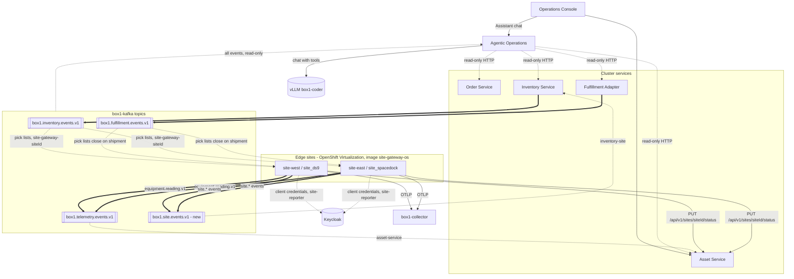

# Box1 service map with edge sites

The second Box1 service map. It adds the Site Expansion work ([#126](https://github.com/box1-org/box1-docs/issues/126)) to the [first map](service-map.md): two RHEL 10 image-mode VMs, `site-west` (`site_ds9`) and `site-east` (`site_spacedock`), acting as remote warehouse sites. It also shows Agentic Operations, which is now live.

Sources: `box1-ops-contracts` `c115534` (`TOPICS.md`, `SITE.md`), the live-check comments on #126 and the [2026-11-10 edge sites log](../achievements/2026/2026-11-10-edge-sites-onboarded.md), as of 2026-11-10 (America/New_York). The interactive version is [`service-map-sites.html`](service-map-sites.html), also published at <https://box1-org.github.io/box1-docs/architecture/service-map-sites.html>.

## What a site runs

Each VM boots one `site-gateway-os` digest that carries the `site-gateway` app bundle:

| Component | Role |
| --- | --- |
| Equipment simulator (Quarkus) | Seeded, deterministic readings over MQTT |
| AMQ Broker (Podman quadlet) | Local MQTT broker |
| `site-gateway` (Quarkus + Camel) | MQTT-to-Kafka forwarder, outbox publisher, pick-list consumer, status heartbeat |
| `site-ops` (Quarkus + Qute) | Handheld UI for pick confirmation, cycle counts and holds |
| PostgreSQL (Podman quadlet) | Local store and bounded outbox buffer |
| OpenTelemetry collector | Traces, journald logs and host metrics to `box1-collector` |
| bootc + greenboot | Image-based updates with automatic rollback |

## Interactions added by Site Expansion

| From | To | What | Mechanism |
| --- | --- | --- | --- |
| Site | `box1.telemetry.events.v1` | `equipment.reading.v1`, keyed by `assetId` | Outbox; `box1-site-id` and `traceparent` headers |
| Site | `box1.site.events.v1` (new) | `site.pick-confirmed.v1`, `site.stock-adjusted.v1`, `site.stock-held.v1`, keyed by `siteId` | Outbox |
| `box1.site.events.v1` | Inventory Service | Group `inventory-site`, DLQ `box1.site.dlq.v1` | Reconciliation rule in `SITE.md` |
| `box1.inventory.events.v1`, `box1.fulfillment.events.v1` | Site | Pick list, group `site-gateway-<siteId>` | Commits offsets after storing; keeps only its own site |
| Site | Asset Service | `PUT /api/v1/sites/{siteId}/status` about every 15 s | Keycloak client per site, role `site-reporter`, `siteId` claim must match |
| Operations Console | Asset Service | Site status for the Sites view | ONLINE, DEGRADED, or OFFLINE after 90 s without status |
| Site | `box1-collector` | OTLP traces, logs, metrics with `site_id` | In-guest collector and Quarkus OTLP |

Deliberately not connected: the sites never talk to the legacy ERP and stay outside the ambient mesh.

## State on 2026-11-10

- **Verified live:** both VMs on OS `sha256:651d4a5f…` (bundle `sha256:26543a45…`) and ONLINE; readings stored from both sites; one breach raised and cleared one alert, traced site → gateway → Asset Service; per-site status write allowed for its own site only (200 / 403 / 401); site holds and a pick confirmation recorded by Inventory Service; logs, metrics and traces visible.
- **Not verified or not run:** console Sites page in a browser; shipment closing a pick list; cycle-count reconciliation and replay; the site-goes-dark, bad-release and reboot drills.
- **Not built:** per-site Kafka identity (blocked on [#71](https://github.com/box1-org/box1-docs/issues/71)); egress NetworkPolicy for site namespaces; automated staged rollout ([#141](https://github.com/box1-org/box1-docs/issues/141)).
