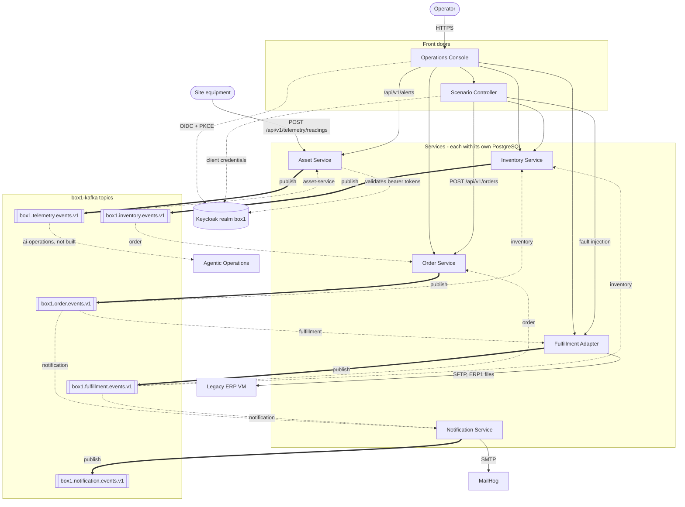

# Box1 service map

How the Box1 operations services interact in the development environment: synchronous HTTP calls, Kafka events on the shared `box1-kafka` cluster, and the external systems at the edges.

Sources: `main` of each `box1-org` service repository, [`box1-ops-contracts/TOPICS.md`](https://github.com/box1-org/box1-ops-contracts/blob/main/TOPICS.md) and the `box1-workloads-dev` deployments, as of 2026-11-06 (America/New_York). An interactive version, where selecting a service lists every call, path and topic it uses, is in [`service-map.html`](service-map.html); download it and open it in a browser.

Solid arrows are HTTP calls or external protocols, thick arrows publish to a topic through the service's outbox, and dotted arrows from a topic are consumer groups. Dotted arrows to Keycloak are identity flows.

## HTTP calls

| Caller | Target | Paths |
| --- | --- | --- |
| Operations Console | Order Service | `/api/v1/orders`, `/api/v1/orders/{orderId}/timeline` |
| Operations Console | Inventory Service | `/api/v1/inventory`, `/api/v1/reservations/{reservationId}` |
| Operations Console | Fulfillment Adapter | `/api/fulfillments` |
| Operations Console | Asset Service | `/api/v1/alerts`, `/api/v1/assets/{assetId}/readings` |
| Operations Console | Scenario Controller | `/internal/v1/scenarios`, `/runs`, `/fixtures`, `/audit` |
| Scenario Controller | Order Service | `POST /api/v1/orders` |
| Scenario Controller | Inventory Service | `/internal/v1/stock/...`, `/internal/v1/sites/...` (Keycloak client-credentials token) |
| Scenario Controller | Fulfillment Adapter | `/internal/fulfillments` |
| Site equipment | Asset Service | `POST /api/v1/telemetry/readings` (bearer token, role `telemetry-writer`) |

The console and Scenario Controller reach the services over cluster-internal URLs such as `http://order-service.order-service-dev.svc:8080`.

## Order lifecycle

1. The Operations Console or a Scenario Controller run sends `POST /api/v1/orders` to Order Service.
2. Order Service stores the order and emits `order.placed.v1` on `box1.order.events.v1`.
3. Inventory Service reserves stock and answers with `inventory.reserved.v1` or `inventory.rejected.v1`.
4. Order Service advances the order and emits `fulfillment.requested.v1`.
5. Fulfillment Adapter queues the request, writes an `ERP1` file to the legacy ERP VM over SFTP (`legacy-erp-sftp.legacy-erp-dev.svc`) and reads back the result file.
6. The adapter emits `shipment.confirmed.v1` or `shipment.failed.v1`; Order and Inventory settle their state.
7. Notification Service reacts to order and shipment events, sends the customer notice through MailHog over SMTP and records `notification.*` events.

## Equipment telemetry

1. Site equipment posts a reading to Asset Service, which returns `202` once Kafka acknowledges `equipment.reading.v1`.
2. The `asset-service` consumer group stores recent readings in PostgreSQL and raises `equipment.threshold-exceeded.v1` alerts with hysteresis.
3. The Operations Console reads `/api/v1/alerts`; Asset Service also serves its own telemetry console at `/console`.

## Topics

| Topic | Producer | Consumer groups on `main` | Listed in the contract only | Retention |
| --- | --- | --- | --- | ---: |
| `box1.order.events.v1` | Order | inventory, fulfillment, notification | bff-projections | 7 d |
| `box1.inventory.events.v1` | Inventory | order | | 7 d |
| `box1.fulfillment.events.v1` | Fulfillment Adapter | order, notification, inventory | | 14 d |
| `box1.telemetry.events.v1` | Asset Service | asset-service | telemetry-projections, ai-operations | 2 d |
| `box1.notification.events.v1` | Notification | | notification-history | 14 d |
| `box1.<domain>.dlq.v1` | Each consumer | operator replay; Notification has an opt-in `notification-replay` group | | 7–14 d |

"Listed in the contract only" means the group appears in `TOPICS.md` but no service on `main` consumes it yet. Agentic Operations is deployed with Kafka enabled but has no consumer.

Delivery is at least once. Consumers record `eventId` with their business effect, and order lifecycle topics are keyed by `orderId`. Event schemas are defined in [`box1-ops-contracts`](https://github.com/box1-org/box1-ops-contracts).
